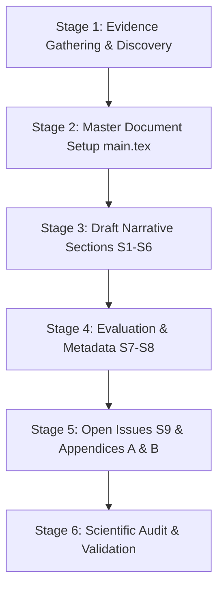

# Write Documentation — Spatial Transcriptomics Knowledge Graph

This skill provides the end-to-end runbook, guidelines, and automated verification tools to write the complete academic and technical project report for the **Spatial Transcriptomics Knowledge Graph** project.

The documentation follows the **iTelos methodology** developed by the KnowDive / DataScientia group (University of Trento) and must strictly comply with:
1. The **DataScientia KG Report Template** specification defined in [Template_KG2026_report-pdf.pdf](../../Documentation/Template_KG2026_report-pdf.pdf).
2. The project scope, technical rules, and scientific boundaries established in [AGENT.md](../../AGENT.md).
3. The LaTeX document structure in [Documentation/knowdive-files/main.tex](../../Documentation/knowdive-files/main.tex) and [Documentation/section/](../../Documentation/section/).

---

## Quick Reference to Skill Resources

- **Section-by-Section Template Guide**: [report_structure.md](./references/report_structure.md) — Detailed requirements, required subsections, and LaTeX tables for Sections 1–9, Appendix A, and Appendix B.
- **iTelos Methodology Mapping**: [itelos_methodology.md](./references/itelos_methodology.md) — How project repository phases (`Phase 1` to `Phase 4`, `Evaluation`, `Metadata`) map to report sections.
- **Scientific Boundaries & Phrasing Cautions**: [scientific_guidelines.md](./references/scientific_guidelines.md) — Mandatory terminology, negative constraints, and phrasing dos and don'ts from `AGENT.md`.
- **LaTeX Conventions & Compilation**: [latex_conventions.md](./references/latex_conventions.md) — Style guide for `knowdive.cls`, Arial fonts, tables, listings, citations, and XeLaTeX compilation.
- **Appendix A Questionnaire Rubric**: [appendix_a_guide.md](./references/appendix_a_guide.md) — Scoring guide for the Common Frequency Scale (CFS) across all 6 phases.
- **Helper Scripts**:
  - [compile_report.py](./scripts/compile_report.py) — Automates the multi-pass XeLaTeX + BibTeX build pipeline with environment path resolution.
  - [generate_report_draft.py](./scripts/generate_report_draft.py) — Scaffolds a complete report draft in `Documentation/` strictly following AGENT.md.
  - [extract_metrics_to_latex.py](./scripts/extract_metrics_to_latex.py) — Extracts graph metrics, resolution counts, and query outcomes into formatted LaTeX tables.
  - [validate_documentation.py](./scripts/validate_documentation.py) — Audits LaTeX files for unreplaced placeholders, missing tables, forbidden claims, and incomplete survey answers.
  - [check_compilation.py](./scripts/check_compilation.py) — Checks LaTeX syntax, citation keys, and environment balancing.

---

## End-to-End Documentation Runbook

Follow this 6-stage workflow when writing or updating the documentation:



### Stage 1: Evidence Gathering & Discovery

Before writing any text, inspect the actual artifacts produced in the project repository:
1. **Inputs & Identifiers**: Confirm versions of MSigDB Hallmark (GMT), CellMarker 3.0 (human markers), and HGNC (`hgnc_complete_set.txt`).
2. **Phase Deliverables**:
   - `Phase 1 - Purpose Definition`: Informal purpose, scenarios, personas, competency questions (CQs), informal eTypes/properties, ER diagram.
   - `Phase 2 - Language Definition`: Language Resource Table, Language Teleontology alignment (Universal Knowledge Core / WordNet), data cleaning notes.
   - `Phase 3 - Knowledge Definition`: Ontology fragments/atoms, Knowledge Teleontology alignment, data shape alignment.
   - `Phase 4 - Entity Definition`: Single-dataset and multi-dataset Karma/RDFLib mappings, deterministic URI policy, resolution audit (`gene_symbol_resolution.csv`).
   - `Evaluation`: Basic graph statistics (`graph_statistics.json`), validation checks (`validation_summary.json`), entity connectivity, SPARQL query results (Q1–Q4).
   - `Metadata`: DC Terms, VoID statistics, resource catalog definitions.
3. If the pipeline has run, use `./scripts/extract_metrics_to_latex.py` to auto-generate the LaTeX tables for evaluation.

### Stage 2: Master Document Setup (`main.tex`)

Edit [Documentation/knowdive-files/main.tex](../../Documentation/knowdive-files/main.tex):
1. **Title**: Set to a formal descriptive title, e.g.:
   `\title{Spatial Transcriptomics Knowledge Graph: iTelos Purpose-Driven Knowledge Graph Report}`
2. **Authors & Reference Persons**: Fill in the author names in `\author{...}`.
3. **Document Identifier / Date**: Update `\docdata{\today}` or the designated release date.
4. **Revision History**: Add a new `\revision{...}` row recording the documentation generation.
5. **Abstract**: Write a self-contained 200–250 word abstract summarizing:
   - Motivation: Providing biological context (pathways, marker genes, cell types) for interpreting spatial transcriptomics data.
   - Methodology: The iTelos methodology (stratified approach: language, knowledge, data layers).
   - Scope: Three entity types (`Gene`, `Pathway`, `CellType`), two biological object properties (`participates_in`, `is_marker_for`).
   - Key Results: HGNC-grounded normalization, SPARQL competency query satisfaction, and graph connectivity.

### Stage 3: Draft Narrative Sections (`S1.tex` to `S6.tex`)

Replace the template guidelines in [Documentation/section/](../../Documentation/section/) with comprehensive technical prose:

#### Section 1: Introduction (`S1.tex`)
- Present the principle of reusability in heterogeneity-aware KGs.
- Introduce the stratified approach of the iTelos methodology.
- Reference the key foundation literature using the provided BibTeX keys in `KnowDivePubs.bib`:
  - `\cite{p3}`: iTelos Purpose-Driven KG Generation
  - `\cite{p1}`: Stratified Data Integration
  - `\cite{p2}`: Popularity-Driven Data Integration
  - `\cite{p4}`: Language and Knowledge Representation (Bagchi 2025)
  - `\cite{p5}`: About Me and You - iTelos (Bocca 2025)
  - `\cite{p6}`: Representation Heterogeneity
- Provide the structured document roadmap.

#### Section 2: Project Design (`S2.tex`)
- **Domain of Interest (DoI)**:
  - Space boundaries: Molecular biology of *Homo sapiens* (human transcriptomics). Explicitly state that the KG provides biological context without directly analyzing raw 2D/3D spatial coordinates, histology images, or spatial spot grids.
  - Time boundaries: Contemporary post-genomic molecular biology, bounded by current curated releases of HGNC, MSigDB Hallmark (v2023.2), and CellMarker (v3.0).
- **General Purpose**:
  - The informal natural-language purpose expressed by domain scientists: integrating human genes, hallmark functional pathways, and curated cell-type markers to support interpretation of spatial transcriptomics spot clusters and tissue frontiers.

#### Section 3: Purpose Definition (`S3.tex`)
- **Purpose Formalization**:
  - *Scenarios*: Usage scenarios (e.g., spot-cluster pathway contextualization, cell-type boundary marker overlap, dual-pathway state comparisons).
  - *Personas*: Real users (e.g., Translational Cancer Biologist, Spatial Genomics Bioinformatician).
  - *Competency Questions (CQs)*: Formulate CQ1 to CQ4 in natural language and formal terms.
  - *Informal Labels & Popularity Categories*: Classify eTypes (`Gene`, `Pathway`, `CellType`) and properties into Core, Common, and Contextual categories.
  - *ER Model Definition*: Describe the Purpose ER Model, cardinalities, and attributes. Include an ER diagram figure or structural description.
- **Information Gathering**:
  - *KnowDive / Existing Resources*: Formal vocabularies, reference schemas.
  - *External Resources*: MSigDB Hallmark (GMT), CellMarker 3.0 (human markers TSV), HGNC complete set (`hgnc_complete_set.txt`). Classify into Core, Common, Contextual.
- **Qualitative Evaluation**:
  - Include the required evaluation tables: Scenarios (initial vs final), Personas (initial vs final), CQs (initial vs final), Dataset Transformations, and Remarks on LLM Usage.

#### Section 4: Language Definition (`S4.tex`)
- **Knowledge Layer**:
  - *Fixing Language Terms*: Finalize terms for eTypes, object properties, and data properties.
  - *Language Teleontology Alignment*: Align terms to parent lexical concepts in the Universal Knowledge Core (UKC) / WordNet. Explain purpose-specific extensions.
- **Data Layer**:
  - Dataset filtering, cleaning, and formatting (whitespace trimming, uppercase normalization, human-only filtering, HGNC approved status matching).
- **Qualitative Evaluation**:
  - Include tables for eTypes term alignment, object property alignment, data property alignment, teleontology enrichment, backtracking notes, and LLM remarks.

#### Section 5: Knowledge Definition (`S5.tex`)
- **Knowledge Layer**:
  - *Teleology Definition*: Compose ontology fragments/atoms (Gene, Pathway, CellType).
  - *Knowledge Teleontology Alignment*: Subclass/subproperty alignment against foundational knowledge teleontology.
- **Data Layer**:
  - Structuring dataset shape to mirror knowledge schema (domain/range constraints, URI formatting).
- **Qualitative Evaluation**:
  - Include tables for eTypes composition/alignment, object properties alignment, data properties alignment, enrichment, backtracking, and LLM remarks.

#### Section 6: Entity Definition (`S6.tex`)
- **Entity Identification & Data Mapping**:
  - *Single Dataset Mapping*: Mapping MSigDB Hallmark, CellMarker, and HGNC records.
  - *Multi-Dataset Composition*: Integrating datasets into the teleontology; resolving shared genes strictly via HGNC IDs.
  - *Karma / Ingestion Pipeline*: Generation of RDF Turtle (`.ttl`), URI minting policies (HGNC ID for resolved genes, local path for unresolved genes, Hallmark IDs, Cell Ontology CL IDs, preserved context literals).
- **Qualitative Evaluation**:
  - Initial vs final entities table, Karma/pipeline iteration table, difficulties encountered (e.g., alias ambiguities, hasAnnotation issues), backtracking notes, and LLM remarks.

---

### Stage 4: Evaluation & Metadata (`S7.tex` and `S8.tex`)

#### Section 7: Evaluation (`S7.tex`)
1. **Final KG Statistics**: Triple count, instances per eType (`Gene`, `Pathway`, `CellType`), assertions per relation (`participates_in`, `is_marker_for`), shared genes, HGNC resolution rate.
2. **Knowledge Layer Evaluation**: Ontological consistency, CQ coverage, schema validation.
3. **Data Layer Evaluation**:
   - Missing-value rate / source completeness table for raw vs processed datasets.
   - Entity connectivity: Formula $\frac{\text{Connected Entities}}{\text{Total Entities}} \times 100\%$, reported overall and per eType.
4. **Query Execution**:
   - Formal evaluation of SPARQL implementations for CQ1–CQ4.
   - Synthetic test graph results (positive, no-match, empty list handling) vs real-data smoke test results.
   - Query test success rate ($\frac{\text{Passed}}{\text{Total}} \times 100\%$).
5. **Qualitative Evaluation**: Issues, highlights, and LLM usage remarks.

#### Section 8: Metadata (`S8.tex`)
1. **Resource Metadata Definitions**:
   - Language resources metadata (lexical terms, glosses, UKC IDs).
   - Knowledge resources metadata (teleology ontology, atoms).
   - Data resources metadata (raw files, sources, retrieval dates, licenses).
   - KG metadata (Dublin Core Terms: title, description, created, source, creator, license; VoID statistics: `void:triples`, `void:entities`, `void:classes`, `void:properties`).
2. **Catalog Distribution Plan**: Publication via DataScientia LiveKnowledge catalog, institutional repositories, and open data portals.
3. **Qualitative Evaluation**: Notes on LLM usage and metadata integrity.

---

### Stage 5: Open Issues (`S9.tex`) and Appendices A & B

#### Section 9: Open Issues (`S9.tex`)
- Scheduling adherence: Analysis of timeline vs actual milestone completion.
- Purpose satisfaction: Detailed verification of how well the KG fulfills CQ1–CQ4 and user requirements.
- Remaining open problems: Handling unapproved gene aliases, non-standard cell types without CL IDs, lack of spatial spot coordinates in current graph scope, future directions.

#### Appendix A: LLM Usage Questionnaire (`secA-Appendix.tex`)
- Complete every question (Q1, Q2 subtasks, Q3, Q4, Q5) for all 6 phases:
  - Phase 1: Purpose Definition (Tasks part 1, part 2, part 3)
  - Phase 2: Language Definition (Tasks a–i)
  - Phase 3: Knowledge Definition (Tasks a–c)
  - Phase 4: Entity Definition (Tasks a–i)
  - Phase 5: Evaluation & Metadata (Tasks part 1 a–j, part 2 a–f)
  - Phase 6: Open Problems & Conclusion (Tasks a–f)
- Use the **Common Frequency Scale (CFS)**: `A. Never`, `B. Rarely`, `C. Sometimes`, `D. Often`, `E. Always`.
- Add brief qualitative commentary justifying the ratings.

#### Appendix B: Technical Appendices (`secB-Appendix.tex`)
- Listing of the 4 formal SPARQL queries (`q1_genes_in_pathway.rq`, `q2_pathways_for_gene.rq`, `q3_pathway_celltype_overlap.rq`, `q4_shared_activated_suppressed_genes.rq`).
- Sample Turtle (`.ttl`) schema and instance snippets.
- Pipeline execution commands and software environment details.

---

### Stage 6: Scientific Audit & Automated Validation

1. **Check Phrasing against [scientific_guidelines.md](./references/scientific_guidelines.md)**:
   - Ensure pathway-cell type overlaps are described as *descriptive overlaps*, never as *pathway activation*, *cell presence*, *tissue frontier localization*, or *causality*.
   - Confirm HGNC is presented as an *identifier normalization reference*, not a biological dataset.
2. **Run Validation Script**:
   ```powershell
   python .agents/skills/write-documentation/scripts/validate_documentation.py
   ```
3. **Verify LaTeX Syntax**:
   ```powershell
   python .agents/skills/write-documentation/scripts/check_compilation.py
   ```
4. **Compile to PDF**:
   ```powershell
   python .agents/skills/write-documentation/scripts/compile_report.py
   ```
5. Confirm no template prompt instructions remain in `S1.tex` through `S9.tex`.
