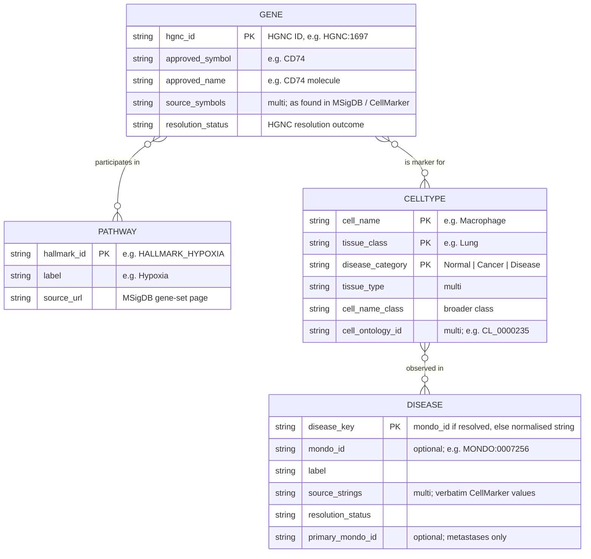

# 6. Purpose ER Model

*Phase 1 (Purpose Definition), Stage 1A: ER modelling.*
*Status: draft for review.*

The ER model is the first version of the knowledge layer of our KG, built around our purpose.
It only contains what we agreed on in the scope: four ETypes and three relations (Disease and
*observed in* were added with the scope change of 2026-11-13, see `04_input_inspection.md` §4.8).

## 6.1 Diagram

Mermaid cannot draw attributes on a relationship, so we list them here:

| Relationship | Attributes |
|---|---|
| GENE — *is marker for* → CELLTYPE | `marker_source`, `method_details`, `pmid` (multi), `year` (multi) |
| GENE — *participates in* → PATHWAY | none (the membership is just as MSigDB states it) |
| CELLTYPE — *observed in* → DISEASE | none (CellMarker has at least one record of the cell type in the disease) |

## 6.2 Focus

| Element | Focus |
|---|---|
| Gene | Common |
| Disease | Common |
| Pathway | Core |
| CellType | Core |
| participates in, is marker for | Core |
| observed in | Common |
| marker evidence, `tissue_type`, `cell_name_class`, Disease `source_strings` / `resolution_status` / `primary_mondo_id` | Contextual |

## 6.3 How to read the model

- Both relations are many-to-many. A gene can belong to several pathways (e.g. `MYC` is in 10)
  and be a marker of several cell types. A pathway contains between 32 and 200 genes.
- Pathway and CellType are **never connected directly**. Their connection (CQ3) is always
  computed through the genes they share, so the KG never asserts pathway activity in a cell
  type.
- Disease is reached from a Pathway only through Gene → CellType → Disease. *observed in* is
  attached to the CellType, not to the single marker, so the KG does not say in which disease a
  marker was reported (D7, CQ3.4).
- CellTypes with `disease_category = Normal` have no *observed in* link, and neither do values
  that are not diseases (D14).
- The groups of activated and suppressed pathways (CQ4) are not part of the model: they are
  given to the query.

## 6.4 What is left for the next phases

| ID | Item | Phase |
|---|---|---|
| O1 | How to write the *is marker for* evidence attributes in RDF without adding a fourth entity type (RDF-star annotation vs. reification vs. audit table only) | Phase 3 |
| O2 | How to build the URI key of a CellType from (`cell_name`, `tissue_class`, `disease_category`) in a deterministic way | Phase 3 |
| O3 | What to do with duplicate rows (D3), and the HGNC resolution rules for unresolved symbols and symbols that differ only in case | Phase 2 |
| O4 | The exact local URI rule for Disease (together with O2) | Phase 3 |
| O5 | Aligning the Disease class to the MONDO root `MONDO:0000001` (*disease*), as CellType is aligned to CL | Phase 3 |
| O6 | The MONDO matching pipeline: D13 metastasis rule, D14 non-disease list, audit log of merges and unresolved strings, review of the merges | Phase 2 (rules) / Phase 4 (pipeline) |
| O7 | Pin the MONDO release used (`mondo.owl`, 2026-11-03) so that results can be reproduced | Phase 4 |
| O8 | Which predicate links a Disease to its MONDO IRI | Phase 3 |
